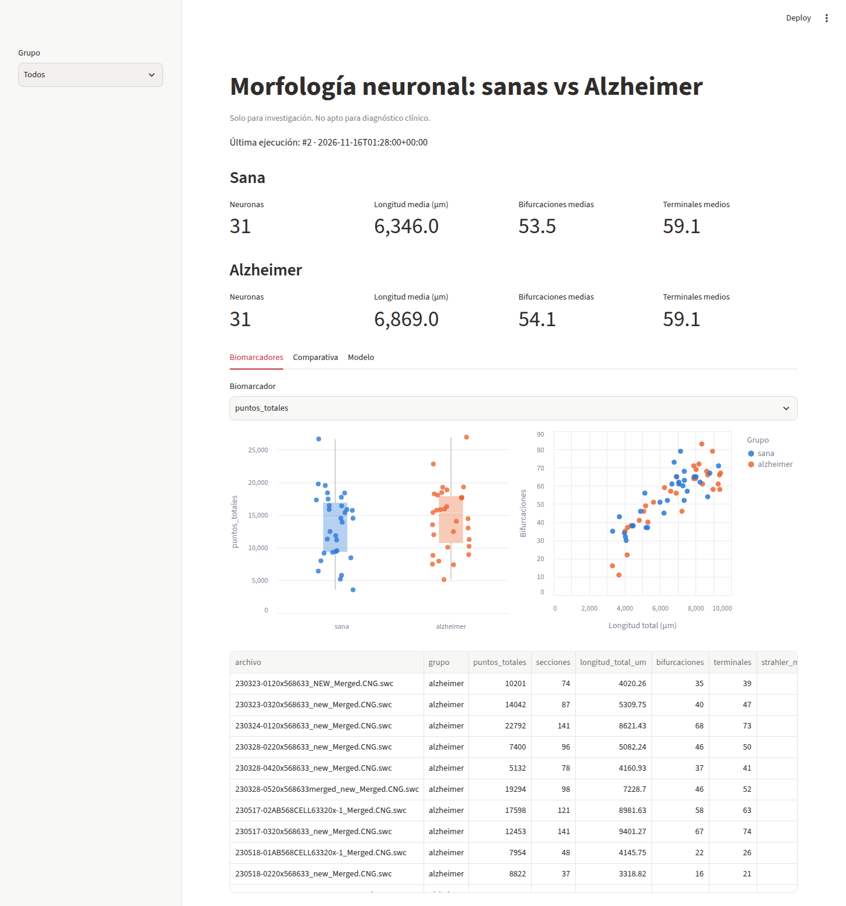
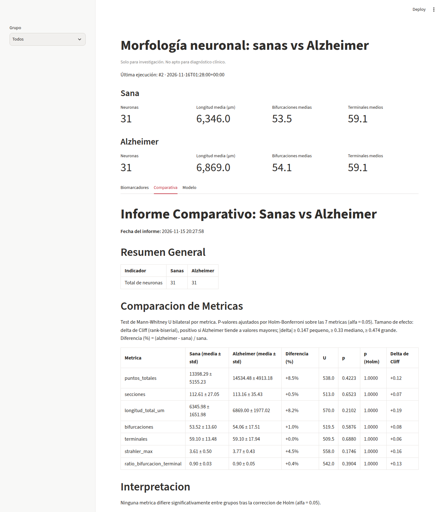
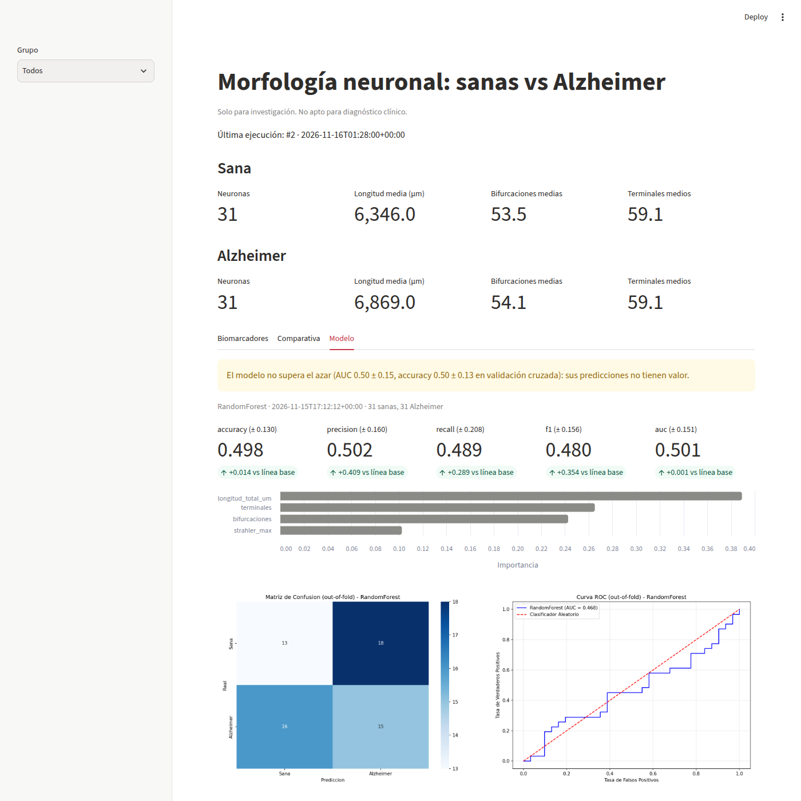

# Análisis de morfología neuronal para la enfermedad de Alzheimer

[English](README.en.md) · **Español**

[](https://python.org)
[](License)
[](https://github.com/BlueBrain/morphio)

Un pipeline para extraer biomarcadores dendríticos de reconstrucciones neuronales (SWC) y comparar neuronas sanas con neuronas de un modelo de Alzheimer, con pruebas estadísticas y un clasificador Random Forest.

> **Resultado principal (negativo):** en un conjunto de datos con grupos comparables (31 neuronas piramidales de CA1 control frente a 31 APP/PS1 del mismo estudio), **ningún biomarcador difiere significativamente** entre grupos y **el clasificador rinde al nivel del azar**. Véase [Resultados](#-resultados).

## 📋 Índice

- [Descripción general](#-descripción-general)
- [Características](#-características)
- [Estructura del proyecto](#-estructura-del-proyecto)
- [Instalación](#-instalación)
- [Conjunto de datos](#-conjunto-de-datos)
- [Uso](#-uso)
- [Biomarcadores](#-biomarcadores-extraídos)
- [Aprendizaje automático](#-aprendizaje-automático)
- [Resultados](#-resultados)
- [Limitaciones](#️-limitaciones)
- [Licencia](#-licencia)
- [Autor](#-autor)

## 🧠 Descripción general

Este proyecto implementa un pipeline para:

1. **Extraer biomarcadores morfológicos** de las dendritas de reconstrucciones neuronales (formato SWC)
2. **Comparar los grupos estadísticamente** (U de Mann-Whitney, corrección de Holm, delta de Cliff)
3. **Evaluar un clasificador Random Forest** con validación cruzada estratificada repetida frente a una línea base trivial
4. **Almacenar y visualizar los resultados** en una base de datos SQLite local, informes estáticos y un panel de Streamlit

Es una herramienta de investigación y docencia. Con el conjunto de datos actual es un pipeline de análisis que informa de un resultado negativo, no un clasificador funcional.

## ✨ Características

| Característica | Descripción |
|---------|-------------|
| **Lectura de SWC** | Carga de morfologías neuronales con `morphio` |
| **Extracción de biomarcadores** | 7 biomarcadores dendríticos por neurona (solo tipos SWC 3 y 4) |
| **Conjunto de datos reproducible** | `scripts/descargar_dataset.py` descarga los datos y escribe `dataset/manifest.csv` con su procedencia |
| **Comparación estadística** | U de Mann-Whitney, corrección de Holm-Bonferroni, delta de Cliff, interpretación y limitaciones generadas automáticamente |
| **Evaluación de ML** | Random Forest, validación cruzada estratificada de 5 particiones repetida (10 repeticiones), línea base `DummyClassifier`, matriz de confusión y curva ROC fuera de partición (out-of-fold) |
| **Persistencia** | Biomarcadores y ejecuciones de entrenamiento almacenados en SQLite (`data/neurona.sqlite3`) |
| **Panel** | Aplicación de Streamlit con las pestañas Biomarcadores / Comparativa / Modelo (la predicción solo está disponible por línea de comandos) |
| **Pruebas** | Batería de `pytest` en `tests/` |

## 📁 Estructura del proyecto

```
neuronal-morphology-alzheimer/
├── dataset/
│   ├── sanas/                  # Neuronas control (etiqueta 0)
│   ├── enfermas/               # Neuronas APP/PS1 (etiqueta 1)
│   └── manifest.csv            # Procedencia de cada archivo SWC
├── scripts/
│   └── descargar_dataset.py    # Descarga el conjunto de datos de NeuroMorpho.org
├── src/
│   ├── classification/
│   │   ├── classifier.py       # Envoltorio de Random Forest
│   │   └── evaluator.py        # CV repetida, matriz de confusión, ROC, informe JSON
│   ├── models/
│   │   └── neuron.py           # Clase Neuron: biomarcadores y orden de Strahler
│   ├── processing/
│   │   ├── analyzer.py         # Extracción de biomarcadores por lotes
│   │   └── storage.py          # Persistencia en SQLite
│   ├── visualization/
│   │   └── plots.py            # Gráficos de barras, dispersión, diagrama de cajas de Strahler
│   └── utils/
│       └── geometry.py         # Distancia euclídea / longitud de sección
├── tests/                      # Batería de pytest
├── resultados/                 # Salidas generadas
│   ├── sanas/
│   ├── alzheimer/
│   ├── comparativa/
│   └── evaluacion/
├── modelos/
│   └── clasificador_neurona.pkl
├── data/                       # Base de datos SQLite (generada, ignorada por git)
├── app.py                      # Panel de Streamlit
├── config.py                   # Rutas y constantes
├── main.py                     # Extracción de biomarcadores + informes
├── train.py                    # Evaluación y entrenamiento del clasificador
├── predecir.py                 # Predicción a partir de un CSV
├── datos_a_predecir.csv        # Entrada de ejemplo para predecir.py
├── pyproject.toml
└── requirements.txt
```

## 🔧 Instalación

### Requisitos previos

- Python 3.12 o superior
- Gestor de paquetes [`uv`](https://docs.astral.sh/uv/) (recomendado)

### Pasos

```bash
git clone https://github.com/xcaim04/neuronal-morphology-alzheimer.git
cd neuronal-morphology-alzheimer
uv sync
```

`uv sync` crea el entorno virtual e instala las dependencias de `pyproject.toml` / `uv.lock` (incluido el grupo `dev` con `pytest`).

Sin `uv`:

```bash
python -m venv .venv
source .venv/bin/activate  # En Windows: .venv\Scripts\activate
pip install -r requirements.txt
```

## 📂 Conjunto de datos

El conjunto de datos contiene **31 neuronas control frente a 31 de un modelo de Alzheimer**, todas del **archivo Booker** de [NeuroMorpho.org](https://neuromorpho.org) (PMID 41651661, doi [10.1523/ENEURO.0099-23.2025](https://doi.org/10.1523/ENEURO.0099-23.2025)):

| | Control (`dataset/sanas/`) | Alzheimer (`dataset/enfermas/`) |
|---|---|---|
| Especie | Ratón | Ratón |
| Cepa | C57BL/6J | Transgénico APP/PS1 |
| Región / tipo celular | CA1, stratum pyramidale / piramidal | CA1, stratum pyramidale / piramidal |
| Edad 6 meses | 13 | 13 |
| Edad 12 meses | 18 | 18 |

Selección (véase el docstring de `scripts/descargar_dataset.py`): solo reconstrucciones `_Merged` (árbol dendrítico completo), solo animales de 6 y 12 meses, y se descartan los archivos que `morphio` no puede abrir.

`dataset/manifest.csv` registra la procedencia de cada archivo (especie, cepa, región, tipo celular, edad, condición, URL). Para reproducir el conjunto de datos:

```bash
uv run python scripts/descargar_dataset.py
```

El conjunto de datos anterior (20 archivos: neuronas de la sustancia negra de rata, células granulares del giro dentado de 5xFAD y controles de otro laboratorio) se eliminó porque los grupos no eran comparables.

### Formato de archivo SWC

El formato SWC contiene 7 columnas por línea:

```
ID  Type    X       Y       Z       Radius  Parent
1   1       0.0     0.0     0.0     5.0     -1
2   3       10.0    5.0     2.0     0.5     1
...
```

| Columna | Descripción |
|--------|-------------|
| ID | Identificador único del punto |
| Type | 1=soma, 2=axón, 3=dendrita basal, 4=dendrita apical |
| X, Y, Z | Coordenadas en micrómetros |
| Radius | Diámetro/2 en micrómetros |
| Parent | ID del punto padre (-1 para la raíz) |

## 🚀 Uso

### 1. Extraer biomarcadores y generar informes

```bash
uv run python main.py
```

Procesa `dataset/sanas/` y `dataset/enfermas/` y almacena los biomarcadores en `data/neurona.sqlite3`.

**Salida** (en `resultados/`):
- `sanas/` y `alzheimer/`: `dataset_biomarcadores.csv`, `informe.md` (con la procedencia tomada del manifiesto), `bifurcaciones_vs_longitud.png`, `strahler_boxplot.png`
- `comparativa/`: `informe_comparativo.md` (pruebas estadísticas, interpretación, limitaciones), `comparacion_<biomarker>.png`, `bifurcaciones_vs_longitud.png`, `strahler_boxplot.png`

### 2. Evaluar y entrenar el clasificador

Requiere los CSV generados por `main.py`.

```bash
uv run python train.py
```

**Salida** (en `modelos/` y `resultados/evaluacion/`):
- `clasificador_neurona.pkl` - Random Forest entrenado con todos los datos
- `metricas_RandomForest.csv` - Métricas de validación cruzada (columnas `metrica,mean,std`)
- `informe_evaluacion.json` - Métricas de validación cruzada del modelo y de la línea base, recuento por clase, hiperparámetros, características
- `importancia_caracteristicas.csv` - Importancia de las características
- `matriz_confusion_RandomForest.png`, `curva_roc_RandomForest.png` - Matriz de confusión y curva ROC fuera de partición

La ejecución del entrenamiento también se almacena en `data/neurona.sqlite3`.

### 3. Panel

```bash
uv run streamlit run app.py
```

Lee la base de datos SQLite y los archivos de `resultados/`; ejecute antes `main.py` y `train.py`.


*Biomarcadores: resumen por grupo, distribución del biomarcador seleccionado y la tabla por neurona.*


*Comparativa: el informe de comparación entre grupos (U de Mann-Whitney, corrección de Holm, delta de Cliff).*


*Modelo: métricas de validación cruzada frente a la línea base, con un aviso cuando el modelo está al nivel del azar.*

### 4. Predecir nuevas neuronas a partir de un CSV

> ⚠️ Con el modelo actual, las predicciones **no tienen valor**: el rendimiento en validación cruzada está al nivel del azar (véase [Resultados](#-resultados)). Por eso la predicción no se ofrece en el panel; `predecir.py` muestra un aviso por stderr mientras el informe de evaluación indique que el modelo está al nivel del azar (AUC media de validación cruzada menos su desviación típica ≤ 0,5).

Cree un archivo CSV con las siguientes columnas:

```csv
longitud_total_um,bifurcaciones,terminales,strahler_max
3500,50,55,3
2000,10,15,2
2800,30,35,2
```

A continuación, ejecute:

```bash
uv run python predecir.py datos_a_predecir.csv -s resultados.csv
```

**O desde Python:**

```python
from predecir import predecir_desde_csv

df_resultado = predecir_desde_csv("datos.csv", "predicciones.csv")
print(df_resultado[["prediccion", "confianza_porcentaje"]])
```

### 5. Pruebas

```bash
uv run pytest
```

## 📊 Biomarcadores extraídos

Todos los biomarcadores se calculan solo sobre las secciones dendríticas (tipos SWC 3 y 4); los axones se ignoran.

| Biomarcador | Columna | Cálculo |
|-----------|--------|-------------|
| **Longitud total** | `longitud_total_um` | Suma de las distancias euclídeas entre puntos consecutivos de cada sección |
| **Bifurcaciones** | `bifurcaciones` | Secciones con ≥2 hijas |
| **Terminales** | `terminales` | Secciones con 0 hijas |
| **Orden de Strahler** | `strahler_max` | Máximo sobre todas las secciones raíz dendríticas |
| **Secciones** | `secciones` | Número de secciones dendríticas |
| **Puntos** | `puntos_totales` | Número de puntos en las secciones dendríticas |
| **Razón bif./term.** | `ratio_bifurcacion_terminal` | Bifurcaciones / Terminales |

### Reglas del orden de Strahler

```
Si el nodo no tiene hijos:                       Orden = 1
Si ≥2 hijos comparten el orden máximo:           Orden = máx + 1
En otro caso:                                    Orden = máx(órdenes_hijos)
```

## 🤖 Aprendizaje automático

### Algoritmo: Random Forest

| Parámetro | Valor |
|-----------|-------|
| `n_estimators` | 100 |
| `max_depth` | 4 |
| `random_state` | 42 |

Características: `longitud_total_um`, `bifurcaciones`, `terminales`, `strahler_max`.

### Evaluación

- **Validación cruzada k-fold estratificada repetida**: 5 particiones x 10 repeticiones; media ± desviación típica sobre las 50 particiones de exactitud (accuracy), precisión, sensibilidad (recall), F1 y AUC ROC
- **Línea base**: `DummyClassifier(strategy="most_frequent")` evaluado con la misma validación cruzada
- **Matriz de confusión y curva ROC**: predicciones fuera de partición de una única división estratificada en 5 particiones
- Después, el modelo final se entrena con todos los datos y se guarda en `modelos/`

## 📈 Resultados

### Comparación entre grupos (`resultados/comparativa/informe_comparativo.md`)

Prueba U de Mann-Whitney bilateral por biomarcador, corrección de Holm-Bonferroni sobre los 7 biomarcadores (α = 0,05). Diferencia = (Alzheimer − control) / control.

| Biomarcador | Control (media ± desv.) | Alzheimer (media ± desv.) | Diferencia | p | p (Holm) | δ de Cliff |
|-----------|----------------------|------------------------|------------|---|----------|-----------|
| puntos_totales | 13398.29 ± 5155.23 | 14534.48 ± 4913.18 | +8.5% | 0.4223 | 1.0000 | +0.12 |
| secciones | 112.61 ± 27.05 | 113.16 ± 35.43 | +0.5% | 0.6523 | 1.0000 | +0.07 |
| longitud_total_um | 6345.98 ± 1651.98 | 6869.00 ± 1977.02 | +8.2% | 0.2102 | 1.0000 | +0.19 |
| bifurcaciones | 53.52 ± 13.60 | 54.06 ± 17.51 | +1.0% | 0.5876 | 1.0000 | +0.08 |
| terminales | 59.10 ± 13.48 | 59.10 ± 17.94 | +0.0% | 0.6880 | 1.0000 | +0.06 |
| strahler_max | 3.61 ± 0.50 | 3.77 ± 0.43 | +4.5% | 0.1746 | 1.0000 | +0.16 |
| ratio_bifurcacion_terminal | 0.90 ± 0.03 | 0.90 ± 0.05 | +0.4% | 0.3904 | 1.0000 | +0.13 |

**Ningún biomarcador difiere significativamente entre grupos.** Todas las diferencias de medias están entre el 0 % y el +8,5 %, con tamaños del efecto pequeños o despreciables.

### Clasificador (`resultados/evaluacion/informe_evaluacion.json`)

| Modelo | Exactitud | Precisión | Sensibilidad | F1 | AUC ROC |
|-------|----------|-----------|--------|----|---------|
| Random Forest | 0.498 ± 0.130 | 0.502 ± 0.160 | 0.489 ± 0.208 | 0.480 ± 0.156 | 0.501 ± 0.151 |
| Línea base (clase más frecuente) | 0.485 ± 0.019 | 0.092 ± 0.185 | 0.200 ± 0.400 | 0.126 ± 0.253 | 0.500 ± 0.000 |

**El clasificador rinde al nivel del azar**: su exactitud y su AUC no se distinguen de las de la línea base. La importancia de las características (`importancia_caracteristicas.csv`) no tiene sentido en un modelo que no discrimina.

### Sobre resultados anteriores

Versiones anteriores de este README informaban de una reducción del 79 % en las bifurcaciones y de una exactitud de clasificación perfecta. Esos resultados eran un artefacto de comparar tipos celulares y especies distintos (sustancia negra de rata / giro dentado de ratón frente a CA1 de ratón), combinado con un error que calculaba el orden de Strahler solo en el primer árbol. No deben citarse.

## ⚠️ Limitaciones

- **El sexo está confundido con el genotipo dentro de cada edad**: a los 6 meses, las 13 neuronas APP/PS1 proceden de machos, frente a 9 machos / 4 hembras en los controles; a los 12 meses, APP/PS1 tiene 12 hembras / 6 machos frente a 12 machos / 6 hembras en los controles.
- **Muestras no independientes**: varias neuronas pueden proceder del mismo animal o corte, y la API de NeuroMorpho no proporciona un identificador de animal, por lo que la validación cruzada no agrupa por animal.
- **Sin diámetros**: las reconstrucciones no contienen radios reales, por lo que no es posible calcular biomarcadores basados en el diámetro.
- **Árboles truncados**: las dendritas están parcialmente cortadas por el seccionado (integridad en NeuroMorpho: "Dendrites Moderate").
- **Datos excluidos**: se excluyeron los animales de 1 mes (aún sin patología amiloide) y se descartaron 5 archivos SWC porque `morphio` no puede abrirlos.
- **Detalles del estudio sin verificar**: no se comprobó en el artículo original si los controles son de la misma camada ni qué línea APP/PS1 se utilizó.
- **Definición de longitud**: la longitud total no incluye el segmento que va del soma al primer punto de cada dendrita (comportamiento de `morphio`).
- **Baja potencia estadística**: con n=31 por grupo, la ausencia de significación no demuestra la ausencia de efecto.
- **Sin validación clínica**: datos de un modelo murino, solo para uso en investigación.

## 📝 Cita

Si utiliza este software en su investigación, cítelo así:

```bibtex
@software{BlancoMoreira2026Neuronal,
  author = {Blanco Moreira, Carlos Javier},
  title = {Neuronal Morphology Analysis for Alzheimer's Disease},
  year = {2026},
  url = {https://github.com/xcaim04/neuronal-morphology-alzheimer},
  note = {Dendritic morphology analysis pipeline, healthy vs. Alzheimer-model neurons}
}
```

## 📄 Licencia

Este proyecto se distribuye bajo una **licencia personalizada**. Consulte el archivo [License](License) para más detalles.

**Resumen:**
- ✅ Se permite el uso académico y de investigación no comercial
- ✅ Se permite la modificación para uso personal
- ❌ Se prohíbe el uso comercial
- ❌ Se prohíbe el diagnóstico médico o clínico
- ❌ Se prohíbe la redistribución sin permiso

Para licencias comerciales, contacte con: [carlojbm04@gmail.com]

## 👤 Autor

**Carlos Javier Blanco Moreira**

- Correo electrónico: carlojbm04@gmail.com
- GitHub: [@xcaim04](https://github.com/xcaim04)

## 🙏 Agradecimientos

- A [NeuroMorpho.org](https://neuromorpho.org) por proporcionar los datos de reconstrucciones neuronales, y a los autores del archivo Booker
- A [BlueBrain/morphio](https://github.com/BlueBrain/morphio) por la lectura de archivos SWC
- A [scikit-learn](https://scikit-learn.org) por las herramientas de aprendizaje automático

---

**Aviso:** Este software es solo para fines de investigación. No está destinado al diagnóstico clínico ni a la toma de decisiones médicas.
